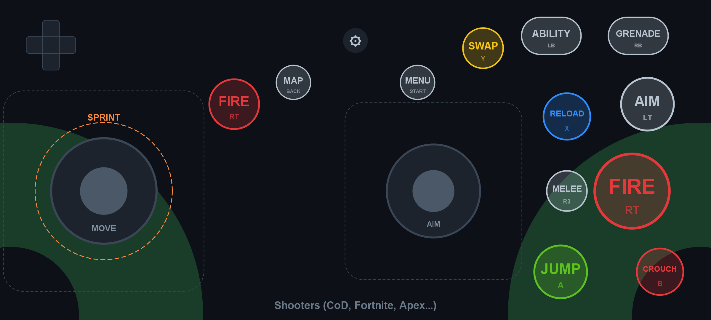
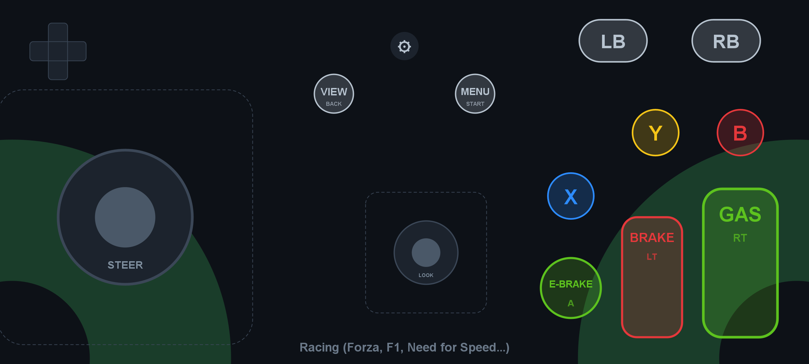
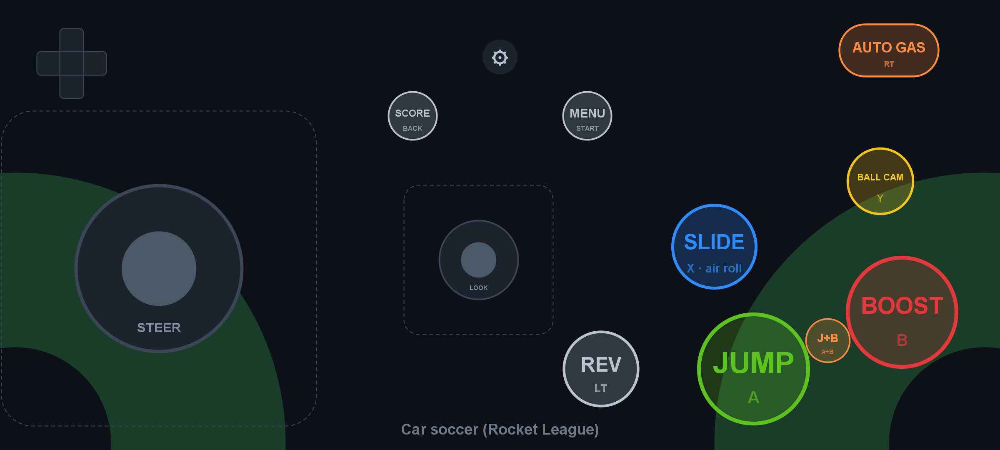
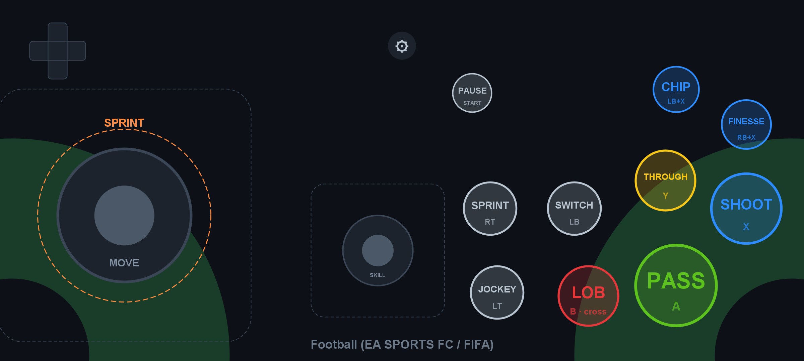
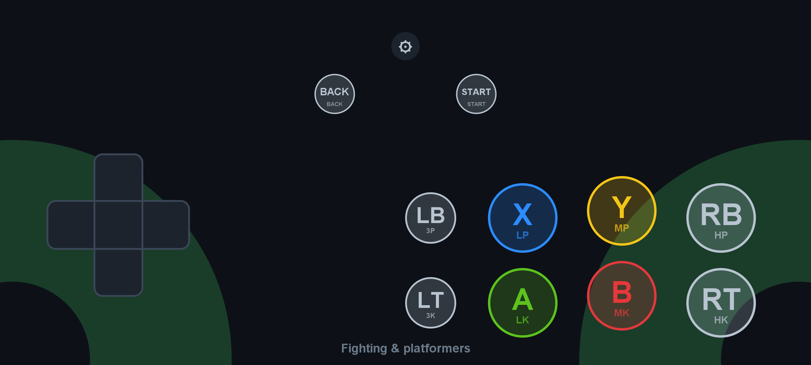
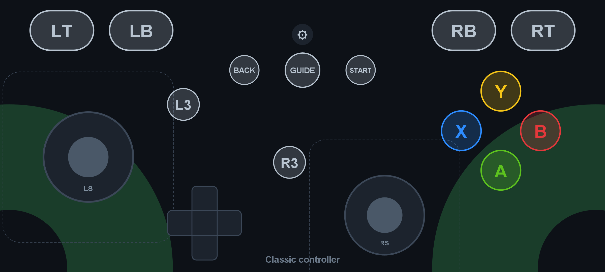
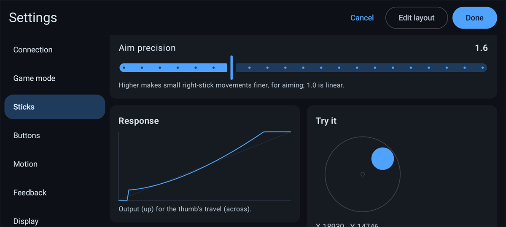
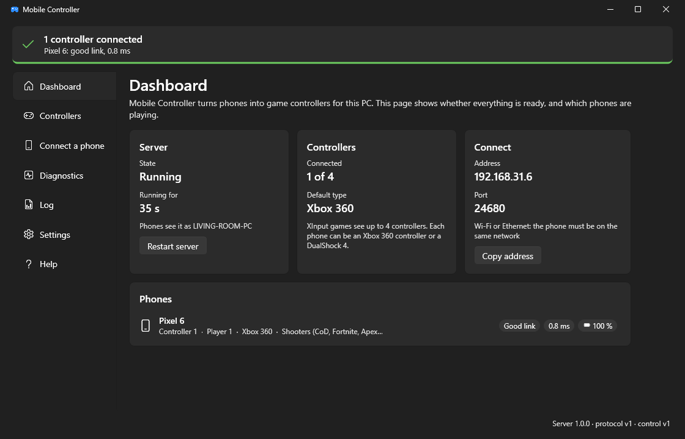
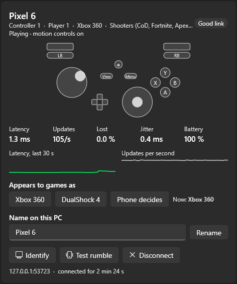

# Mobile Controller

**Turn Android phones into game controllers for a Windows PC.** The phone shows a touch gamepad built for the kind of
game you play. The PC presents each phone to games as a real Xbox 360 or DualShock 4 controller. Several phones can
play at once (four by default, up to eight), over Wi-Fi or a USB cable.



- **Layouts made for each kind of game.** Six game modes (shooters, racing, car soccer, football, fighting and
  platformers, classic), each one movable and resizable. The phone can switch modes by itself when the PC starts a
  game it knows.
- **It feels like a controller.** Sticks that appear under your thumb, a sprint ring, analog pedals, gyro aiming, tilt
  steering, haptic ticks and the game's rumble. Quick taps always arrive.
- **Every setting, live.** Deadzones, response curves, gyro smoothing and haptic strength apply while you change them.
  You can try them on a test stick before saving.
- **A desktop app that explains itself.** It shows whether everything is ready, every phone's battery, latency and link
  quality, the live input, diagnostics and the log. Every server option is in plain language.

## Download

| For | Download |
|---|---|
| The phone (Android 8.0 or newer) | [MobileController.apk](https://github.com/Mo7ammedXD/Mobile-controller/releases/latest/download/MobileController.apk) |
| The PC (Windows 10 or 11, 64-bit) | [MobileController-Windows-x64.zip](https://github.com/Mo7ammedXD/Mobile-controller/releases/latest/download/MobileController-Windows-x64.zip), and the [ViGEmBus 1.22.0](https://github.com/nefarius/ViGEmBus/releases) driver |

These links always point at the newest version. Older versions and release notes are on the
[Releases](https://github.com/Mo7ammedXD/Mobile-controller/releases) page. [Quick start](#quick-start) shows how to
install and connect them.

## Contents

- [How it works](#how-it-works)
- [Quick start](#quick-start)
- [The phone app](#the-phone-app)
- [The desktop app](#the-desktop-app)
- [Connecting](#connecting)
- [Xbox 360 or DualShock 4](#xbox-360-or-dualshock-4)
- [Server options](#server-options)
- [Troubleshooting](#troubleshooting)
- [Building from source](#building-from-source)
- [Making a release](#making-a-release)
- [Project layout](#project-layout)

## How it works


1. **The phone draws the controller and reads your thumbs.** Touches, the gyroscope and tilt are turned into one
   controller state: buttons, two sticks and two triggers. This path allocates no memory, so handling your input
   never causes a garbage-collection pause.
2. **The phone sends that state to the PC over UDP.** Every packet carries the *whole* state (16 bytes), so a lost
   packet is simply replaced by the next one. The phone sends on every change, and at least 120 times a second by
   default.
   Next to the input, it reports its name, battery, latency and game mode (STATUS).
3. **The server on the PC gives each phone a controller.** It plugs in a virtual pad through the
   [ViGEmBus](https://github.com/nefarius/ViGEmBus) driver, so Windows and games see an ordinary Xbox 360 or
   DualShock 4 controller. If a phone goes quiet for half a second, its inputs are released. After 10 seconds its
   controller is unplugged.
4. **Feedback goes back to the phone.** The server sends the player number and the game's rumble (FEEDBACK). The
   desktop app can ask a phone to identify itself (COMMAND), and the phone then vibrates and flashes.
5. **The desktop app watches and configures the server.** The app and the server are separate processes, connected
   by named pipes. That way the input loop never shares a garbage collector with a user interface, and the server
   also runs on its own without a window.

The wire format is specified in [docs/PROTOCOL.md](docs/PROTOCOL.md), with golden test vectors that both sides test
against.

## Quick start

**You need:**

- A Windows 10 or 11 PC.
- An Android 8.0 or newer phone.
- The phone and the PC on the same Wi-Fi, or a USB cable.

**On the PC:**

1. Install the controller driver, [ViGEmBus 1.22.0](https://github.com/nefarius/ViGEmBus/releases).
2. Download [MobileController-Windows-x64.zip](https://github.com/Mo7ammedXD/Mobile-controller/releases/latest/download/MobileController-Windows-x64.zip),
   extract it to a folder (not just open it: the app needs the files next to it) and run **MobileController.exe**.
   If Windows SmartScreen warns about an unknown publisher, click **More info**, then **Run anyway**. To run it from
   source instead, see [Building from source](#building-from-source).

   The app starts the server for you. The Dashboard's **setup checklist** covers the driver, the firewall rule (one
   click; Windows asks for administrator rights), the network and your first phone.

**On the phone:**

1. Download [MobileController.apk](https://github.com/Mo7ammedXD/Mobile-controller/releases/latest/download/MobileController.apk)
   on the phone and open it to install it. If Android asks, allow your browser (or file manager) to install apps.
   Open the app, and allow **local network access** if Android asks (Android 17 and newer).
2. Tap the gear, then **Find PC**, and pick your PC. You can also scan the QR code on the desktop app's
   **Connect a phone** page with the phone's camera.
3. Pick a **game mode** that matches your game, tap **Done**, and play.

## The phone app

### Game modes

Each mode is a layout for how a kind of game is played: what your thumbs do at the same time, what is held, and what
is tapped. The green arcs show where thumbs rest comfortably. The dashed boxes show where a stick appears when your
thumb lands.

| | |
|---|---|
|  **Shooters**: move, aim and fire at the same time. Call of Duty, Fortnite, Apex, Halo. |  **Racing**: steering with analog gas and brake pedals, or tilt steering. Forza, F1, Need for Speed. |
|  **Car soccer**: steer plus three big actions. Rocket League. |  **Football**: run, pass and shoot, with sprint held. EA SPORTS FC, FIFA. |
|  **Fighting & platformers**: precise directions and many buttons pressed together. |  **Classic controller**: every button of a real pad, for anything else. |

When the PC reports the game in the foreground, the phone can switch to that game's mode by itself
(**Settings → Connection → Switch mode for the game on the PC**). To move and resize controls, open the settings and
tap **Edit layout**. Then drag to move, and pinch or use **−** / **+** to resize. **Snap**, **Undo** and **Reset** are
in the toolbar. Each mode keeps its own layout. [docs/GAME_MODES.md](docs/GAME_MODES.md) explains why each layout
looks the way it does.

### Settings



The gear opens the settings over the controller. The phone stays connected underneath, so the PC keeps its controller
while you change things. Changes to feel, gyro and haptics apply as you make them: try a deadzone on the **Try it**
stick or feel a haptic strength with **Test**. **Done** (or Back) saves; **Cancel** puts everything back.

| Section | What's in it |
|---|---|
| **Connection** | Live status (player, latency), the PC's address and port, **Find PC**, recently used PCs, Xbox 360 or DualShock 4, the send rate (30–250 Hz), automatic game modes |
| **Game mode** | The six modes, buttons that follow your thumb, left-handed (mirrored) layout |
| **Sticks** | Per stick: deadzone, outer deadzone, deadzone shape (round, per axis, snap to axes), where the stick appears, invert. Per mode: anti-deadzone, sensitivity, aim precision. A response curve and a test stick |
| **Buttons** | Shortest press, D-pad deadzone, diagonal width and four-way mode, the sprint ring, pedal response |
| **Motion** | Gyro aiming or tilt steering, sensitivity per axis, invert, axis mode, smoothing, tightening, acceleration, drift correction, **Calibrate gyro**, and a live view of the gyro's output |
| **Feedback** | Haptic strength and which events vibrate, with **Test** buttons; rumble strength and how the PC's two motors map to the phone's one |
| **Display** | Dim the screen while playing |
| **About** | App version, this phone's name and device id, protocol version |

**Settings worth knowing:**

- **Shortest press** (default 20 ms): a tap shorter than this is held this long. A game that reads the controller
  once per frame still sees it, and a lost packet can't swallow it. A quick double tap still arrives as two taps.
- **Anti-deadzone**: starts the output just past the game's own deadzone, so small thumb movements register at once.
- **Gyro aiming**: smoothing calms slow, fine aim without delaying fast turns. If the aim drifts while the phone lies
  still, use **Calibrate gyro**. The app also corrects drift by itself whenever the phone rests.
- **Haptics** work even when Android's system touch feedback is off.
- **Finding the PC again**: the app remembers the PCs it connected to. If a PC's address changes (a new DHCP lease),
  the app looks for it by name. If the phone's Wi-Fi changes, the PC keeps the same controller for it instead of
  plugging in a new one.

## The desktop app



The banner at the top always says the one thing worth knowing right now, such as "Ready: waiting for a phone",
"2 controllers connected" or "The controller driver is missing". When there is something to fix, it has a button
that fixes it.

| Page | What it does |
|---|---|
| **Dashboard** | The setup checklist (driver, firewall, network, first phone), the server's state and uptime, the address phones connect to, and every phone at a glance with link quality, latency and battery |
| **Controllers** | One card per phone. See below |
| **Connect a phone** | A QR code to scan with the phone's camera, and this PC's addresses (USB tethering first), refreshed when networks change |
| **Diagnostics** | Per-phone packet gaps (p50, p95, p99, max), jitter and loss; the health of the receive loop and garbage collector; a full system check; a test controller that moves by itself, as Xbox 360 or DualShock 4; **Export diagnostics**, a zip for bug reports |
| **Log** | The server's log, live, with a level filter and search. It is also written to `%LOCALAPPDATA%\MobileController\logs` |
| **Settings** | Every server option in plain language, plus start with Windows, notifications and light or dark theme |
| **Help** | What to try when the phone doesn't find the PC, the game doesn't react, or it lags |



**A phone's card on the Controllers page** (on the right) shows:

- What the game sees from that phone right now: sticks, triggers and every button lit while pressed, plus a bar while
  the game rumbles.
- Latency, updates per second, packet loss, jitter and battery, with 30-second graphs.
- **Appears to games as**: Xbox 360, DualShock 4, or the phone's own choice.
- **Name on this PC**: your own name for the phone.
- **Identify**: the phone vibrates and flashes for 3 seconds, so you can tell several phones apart.
- **Test rumble** and **Disconnect**.

Closing the window keeps the phones working from the notification area. Only one copy of the app runs at a time. The
server runs in a Windows job object, so it never outlives the app.

<br clear="right">

## Connecting

| Link | When to use it |
|---|---|
| **USB tethering** | The fastest and steadiest link. Connect the phone by USB and turn on **USB tethering** in Android's network settings. The PC sees a new network adapter, and the desktop app lists it first. |
| **Wi-Fi** | The phone and the PC on the same network. 5 GHz Wi-Fi works best. Guest networks often block devices from reaching each other. |

There are three ways to point the phone at the PC:

- **Find PC** in the phone's settings. It broadcasts on the local network, and every running server answers with its
  name.
- **The QR code** on the desktop app's **Connect a phone** page. The phone's camera opens the app, which asks before
  it connects.
- **Type the address** shown on the Dashboard. The port is `24680` unless you changed it.

**Windows Firewall** must let the server receive UDP on its port. The Dashboard checks this and offers a one-click fix
that runs [server/scripts/Add-FirewallRule.ps1](server/scripts/Add-FirewallRule.ps1) as administrator.

## Xbox 360 or DualShock 4

Each phone can appear to games as an Xbox 360 controller (the default) or as a DualShock 4. With a DualShock 4, games
and Steam show PlayStation button prompts, and the phone labels its buttons ✕ ○ □ △. Games that only speak XInput
don't see a DualShock 4, so use Xbox 360 for them.

When more than one choice applies, the first match wins:

1. Per phone, on the desktop app's Controllers page (`devices` in the settings file).
2. On the phone: **Settings → Connection → Controller on the PC**.
3. For all phones: `defaultOutput` in the settings file, or `--default-output ds4`.
4. Otherwise, Xbox 360.

## Server options

The desktop app's Settings page edits these for you. They live in `%APPDATA%\MobileController\server.json`, and
every key is optional:

```jsonc
{
  "schema": 1,
  "port": 24680,
  "bind": "0.0.0.0",
  "maxPads": 4,                 // 1-8; XInput games see only 4
  "neutralTimeoutMs": 500,      // release all inputs after this long without input
  "disconnectTimeoutMs": 10000, // unplug a controller after this long without any packet
  "allow": ["192.168.1.50"],    // accept only these phones (empty or missing = any)
  "name": "Living room PC",     // what phones see when they search
  "gameDetect": true,           // tell phones the foreground game, for automatic modes
  "defaultOutput": "xbox360",   // or "ds4"
  "devices": [                  // per phone, by the device id in the phone's Settings → About
    { "id": "3F2A9C0D11E4B7A5", "alias": "Sam's phone", "output": "ds4" }
  ],
  "verbose": false,             // per-phone statistics every 5 s
  "highPriority": false,
  "logToFile": true,            // rotated at 2 MB, 4 old files kept
  "logFilePath": null           // default: %LOCALAPPDATA%\MobileController\logs\server.log
}
```

The server also runs on its own, without the desktop app. Options on the command line win over the file:

```powershell
dotnet run --project server\src\MobileController.Server -- --help            # every option
dotnet run --project server\src\MobileController.Server -- --diagnose        # check driver, port, adapters, power
dotnet run --project server\src\MobileController.Server -- --test-pattern 10 # a controller that moves by itself
dotnet run --project server\src\MobileController.Server -- --dry-run --verbose  # log packets, no virtual controller
```

## Troubleshooting

The status line at the top of the phone's screen says what the phone sees:

| The phone says | What it means and what to do |
|---|---|
| **No PC selected** | Tap the gear, then **Find PC**, or scan the desktop app's QR code. |
| **Waiting for PC** | Nothing answers. Check that the desktop app is running and the address is right. Allow the app through Windows Firewall (Dashboard). Check that both devices are on the same network, and try USB tethering. |
| **PC not listening** | The PC is there, but nothing listens on that port. Start the desktop app, or check the port. |
| **Server full** | Every controller slot is taken: 4 by default, up to 8 with `maxPads`. |
| **Permission needed** / **Local network access blocked** | Android 17 and newer ask for local network access. Allow it, or enable it under **App info → Permissions**. |
| **No network route to the PC** | The phone isn't on a network that reaches the PC. Turn on Wi-Fi, or USB tethering. |
| **Unknown host** | The typed name can't be found. Use the PC's IP address. |

More problems and fixes:

- **Find PC finds nothing, but typing the address works.** The router or the firewall blocks broadcasts. Type the
  address or scan the QR code.
- **The game doesn't react.** Check the Dashboard: if the driver is missing, install ViGEmBus. If the phone is a
  DualShock 4 and the game only speaks XInput, switch that phone to Xbox 360.
- **Input stutters or lags.** Use USB tethering or 5 GHz Wi-Fi. The Diagnostics page shows each phone's packet gaps
  and jitter, so you can see whether the network is the cause.
- **The gyro aim drifts.** Lay the phone down and use **Settings → Motion → Calibrate gyro**.

## Building from source

**You need:**

- For the desktop app and server: the [.NET 10 SDK](https://dotnet.microsoft.com/download).
- For the phone app: JDK 17 or newer and the Android SDK with platform 37. Android Studio includes both.

**On Windows (PowerShell):**

```powershell
# Desktop app and server
dotnet build server\MobileController.slnx
dotnet run --project server\src\MobileController.Desktop

# Phone app: build, then install on a phone connected with USB debugging
cd android
.\gradlew.bat :app:assembleDebug
adb install -r app\build\outputs\apk\debug\app-debug.apk

# Tests
.\gradlew.bat :app:testDebugUnitTest :app:lintDebug
cd ..\server # dotnet test finds global.json, which selects the test runner, only from here or below
dotnet test --solution MobileController.slnx
```

The phone app builds and tests on any OS (`./gradlew` instead of `.\gradlew.bat`). The server and the desktop app
target `net10.0-windows`. On other operating systems:

- Compile them with `dotnet build server/MobileController.slnx -p:EnableWindowsTargeting=true`.
- `server/tests/MobileController.Control.Tests` runs anywhere.
- The server tests need Windows. The ViGEm integration tests also need the driver installed.

Both input paths have tests that fail if they allocate memory: `ZeroAllocationTest` on the phone and
`AllocationTests` on the server.

## Making a release

People download the apps from the [Releases](https://github.com/Mo7ammedXD/Mobile-controller/releases) page, and the
links under [Download](#download) always point at the newest release. A release has two files:

- `MobileController-Windows-x64.zip`: the desktop app and the server, self-contained, so the PC needs no .NET.
- `MobileController.apk`: the phone app, signed with your release key.

**Once: create the signing key.** Android installs an update over the app only if the update is signed with the same
key. Keep `android\release.jks` and its password safe. Git ignores both `release.jks` and `keystore.properties`. In
PowerShell, from the repository root:

```powershell
$password = Read-Host 'A password for the signing key (6 or more characters, no backslash)'
# Android Studio's keytool; any JDK's keytool works too.
& "$env:ProgramFiles\Android\Android Studio\jbr\bin\keytool.exe" -genkeypair -keystore android\release.jks `
    -alias mobilecontroller -keyalg RSA -keysize 2048 -validity 10000 -storepass $password -dname 'CN=Mobile Controller'
# Tells Gradle how to sign release builds.
Set-Content android\keystore.properties "storeFile=release.jks`nstorePassword=$password`nkeyAlias=mobilecontroller`nkeyPassword=$password"
# The same key for the release builds on GitHub (needs the GitHub CLI, gh).
gh secret set ANDROID_KEYSTORE_BASE64 --body ([Convert]::ToBase64String([IO.File]::ReadAllBytes("$PWD\android\release.jks")))
gh secret set ANDROID_KEYSTORE_PASSWORD --body $password
```

**Build both files on your PC** (into `dist\`):

```powershell
powershell -ExecutionPolicy Bypass -File scripts\Build-Release.ps1 -Version 1.0.0
```

`-SkipAndroid` builds only the zip, and `-SkipWindows` only the APK. Without `-Version`, the apps keep the versions in
their project files.

**Publish a release** by pushing a version tag. GitHub then builds both files with the same script
([.github/workflows/release.yml](.github/workflows/release.yml)) and publishes them as a release:

```powershell
git tag v1.0.0
git push origin v1.0.0
```

The tag sets the version of both apps. The APK's version code grows with it (1.2.3 becomes 10203), so phones accept
each release as an update. To publish files you built yourself instead, run
`gh release create v1.0.0 dist\MobileController-Windows-x64.zip dist\MobileController.apk`.

## Project layout

| Path | What it is |
|---|---|
| `android/` | The phone app (Kotlin): a canvas-drawn controller and a Jetpack Compose settings screen |
| `server/src/MobileController.Server` | The server: a .NET 10 console app that receives the phones' packets and drives ViGEmBus |
| `server/src/MobileController.Desktop` | The desktop app (WPF): starts and watches the server, with status, diagnostics and settings |
| `server/src/MobileController.Control` | What the server and the desktop app share: control-pipe messages, the settings file, adapter hints |
| `server/scripts/` | The firewall rule script |
| `scripts/Build-Release.ps1` | Builds the release downloads: the Windows zip and the signed APK |
| `docs/PROTOCOL.md` | The wire protocol. Both sides implement it and test against its golden vectors |
| `docs/GAME_MODES.md` | The touch layouts and why they look the way they do |
